# Reporte tarea exploracion de la planificación de procesos en XV6

**Curso:** Sistemas Operativos

**Estudiantes:** 
- Douglas Velez Monginaite (2516737) 
- Lesly Sharif Zapata Gómez (2516574)

## Inicio de la tarea

### 1. Preparar el repositorio y el entorno

#### *1. Clonación del repositorio oficial de XV6 para RISC-V*
```bash
git clone https://github.com/Arlettly/xv6-riscv # Dirección de nuestro Fork
```
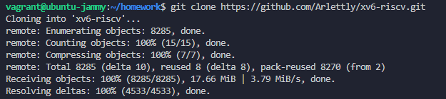

#### *2. Versión de Linux del sistema e identificacion del commit desde el cual se comienza a trabajar*
```bash
uname - a # Para la versión de linux
git log --oneline -1 # Para el ultimo commit
```
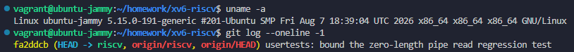

#### *3. Identificación y verificación de las herramientas necesarias*
```bash
sudo apt-get install -y gcc-riscv64-unknown-elf qemu-system-misc
```

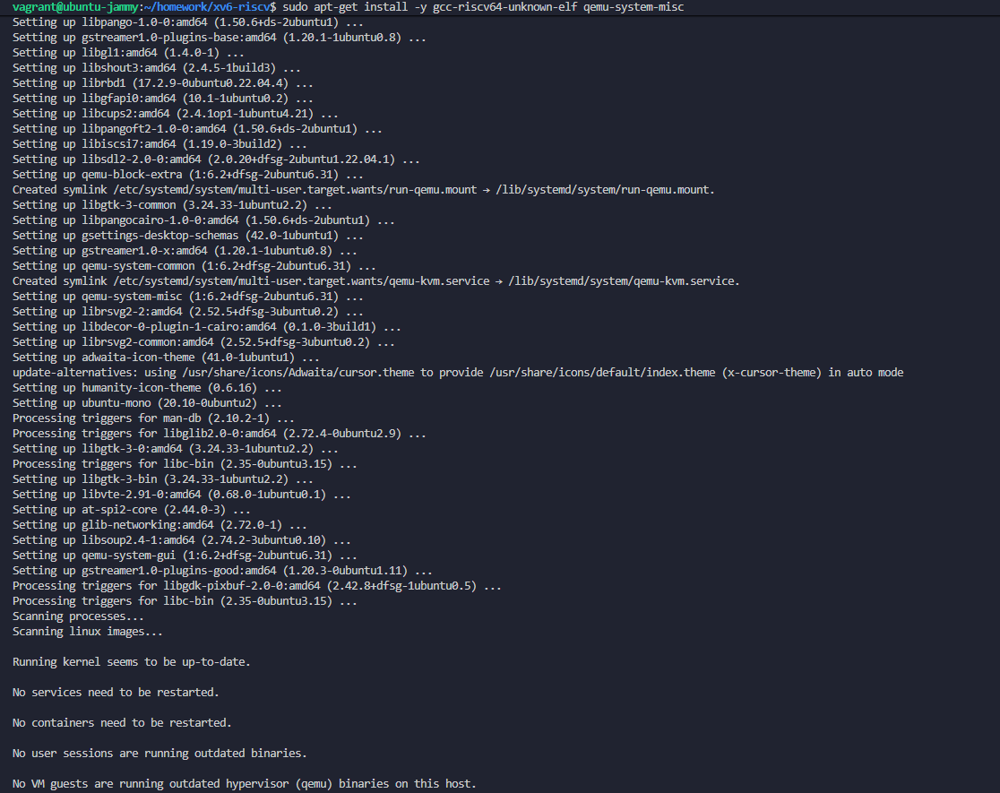


#### Hay que aclarar que al principio no nos funciono correctamente el qemu debido a que se necesitaba una version posterior, por lo que debimos instalarlo nuevamente
``` bash
sudo apt install -y software-properties-common
```
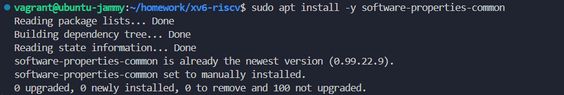
``` bash
sudo add-apt-repository -y ppa:canonical-server/server-backports
```
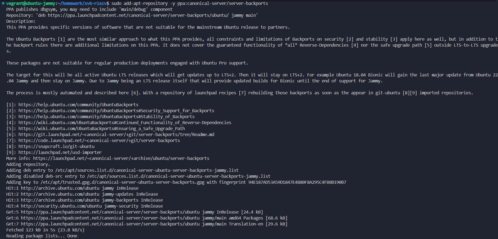
``` bash
sudo apt install -y qemu-system-misc
```
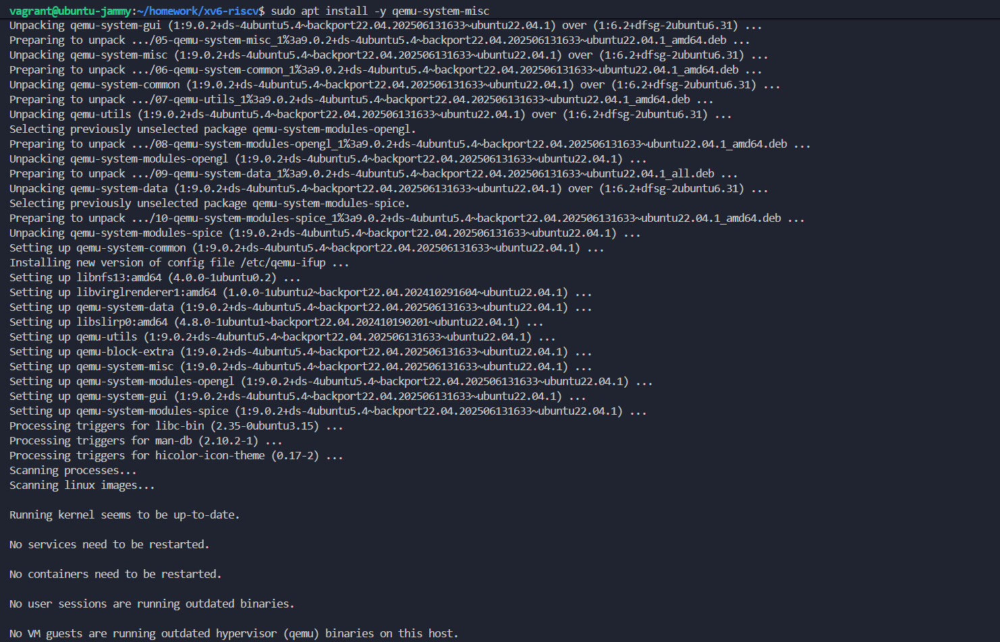

#### *4. Instalación del Make*
```bash
sudo apt install make 
```
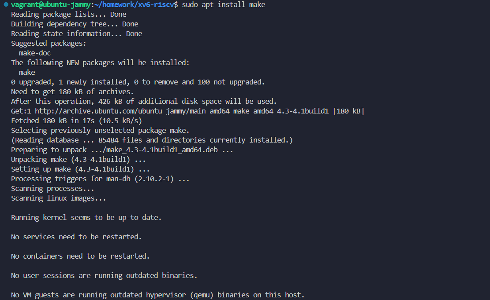

#### *5. Versiones de las herramientas usadas*

```bash
riscv64-unknown-elf-gcc --version
qemu-system-riscv64 --version
make --version
```

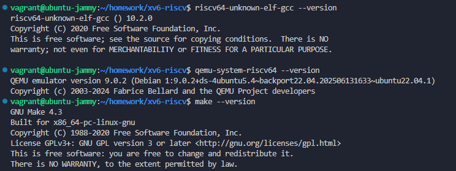

### 2. Compilación de XV6

#### *1. Compilar XV6 usando el comando Make*
```bash
make
```
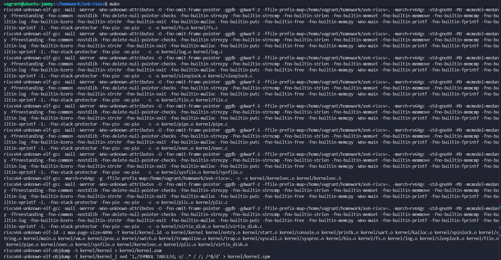

#### *2. Ejecutar XV6 con 1 sola CPU virtual*

El número de CPUs virtuales en XV6 se controla mediante la variable `CPUS` y se encuentra en el `Makefile`.

Por eso para ejecutar 1 sola CPU virtual se tiene que utilizar el comando
```bash
make qemu CPUS=1
```
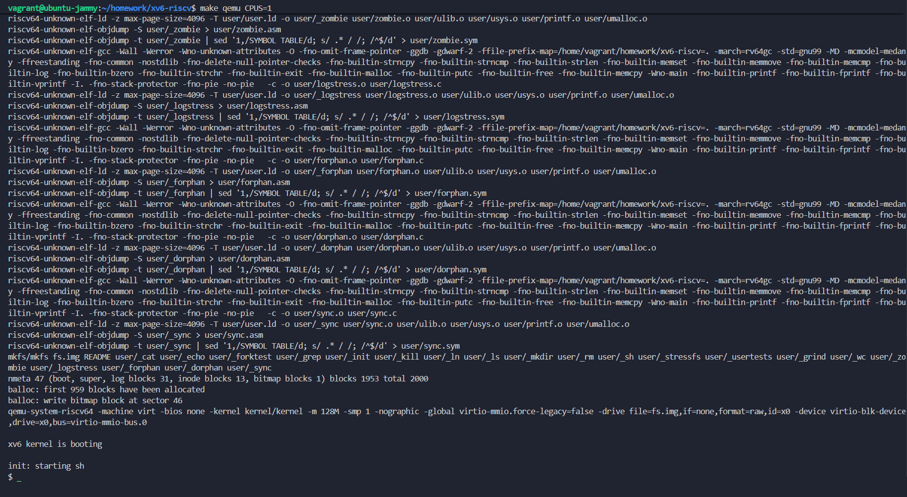

#### *3. Comprobación de que XV6 esta operando*
```bash
ls # lista los archivos disponibles en el sistema de archivos de XV6
```
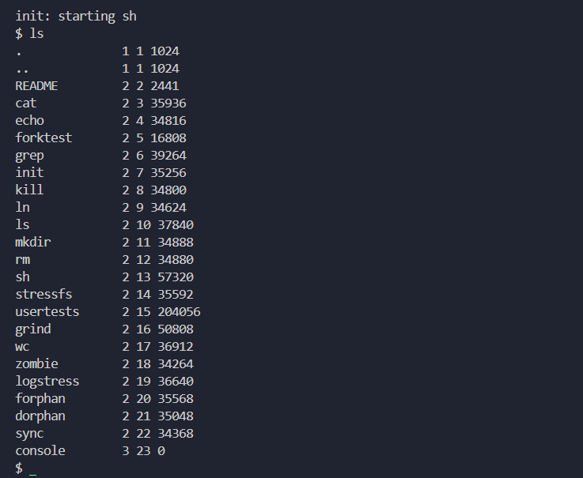

```bash
cat README # muestra el contenido del archivo README incluido en el repositorio
```
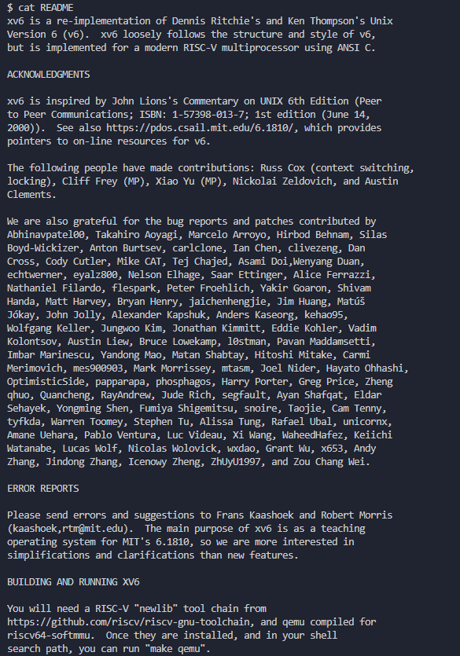

### 3. Investigar el planificador original

#### *1. ¿Qué algoritmo de planificación utiliza XV6?*

XV6 utiliza el algoritmo *Round Robin (RR)*. Este algoritmo recorre todos los procesos en orden, le da la CPU a cada uno por un turno y al terminar ese turno pasa al siguiente. Ningún proceso tiene prioridad sobre otro.

Esto se puede ver en el comportamiento del sistema porque si corremos varios procesos al tiempo, todos van avanzando de a poco, ninguno se queda bloqueando a los demás. El planificador no le da ventaja a ningún proceso, simplemente los va rotando en orden.

#### *2. ¿En qué archivo y función se implementa?*

Está en el archivo `kernel/proc.c`, en la función `scheduler()`. Lo que hace esta función es un bucle infinito que va revisando todos los procesos uno por uno, y cuando encuentra uno en estado `RUNNABLE` le da la CPU:

```c
// Per-CPU process scheduler.
// Each CPU calls scheduler() after setting itself up.
// Scheduler never returns.  It loops, doing:
//  - choose a process to run.
//  - swtch to start running that process.
//  - eventually that process transfers control
//    via swtch back to the scheduler.
void
scheduler(void)
{
  struct proc *p;
  struct cpu *c = mycpu();

  c->proc = 0;
  for (;;) {
    // The most recent process to run may have had interrupts
    // turned off; enable them to avoid a deadlock if all
    // processes are waiting. Then turn them back off
    // to avoid a possible race between an interrupt
    // and wfi.
    intr_on();
    intr_off();

    int found = 0;
    for (p = proc; p < &proc[NPROC]; p++) {
      acquire(&p->lock);
      if (p->state == RUNNABLE) {
        // Switch to chosen process.  It is the process's job
        // to release its lock and then reacquire it
        // before jumping back to us.
        p->state = RUNNING;
        c->proc = p;
        swtch(&c->context, &p->context);

        // Don't re-enable interrupts on release.
        mycpu()->intena = 0;

        // Process is done running for now.
        // It should have changed its p->state before coming back.
        c->proc = 0;
        found = 1;
      }
      release(&p->lock);
    }
    if (found == 0) {
      // nothing to run; stop running on this core until an interrupt.
      asm volatile("wfi");
    }
  }
}
```
El bucle interno `for(p = proc; p < &proc[NPROC]; p++)` es el que recorre todos los procesos en orden, que es justamente lo que hace Round Robin.


#### *3. ¿Cómo se relaciona con los estados y los eventos?*

Los estados de los procesos están definidos en `kernel/proc.h`:

```c
enum procstate { UNUSED, USED, SLEEPING, RUNNABLE, RUNNING, ZOMBIE };
```

La relación funciona así: el planificador agarra un proceso `RUNNABLE`, lo pone en `RUNNING` y le da la CPU. Ese proceso corre hasta que llega una interrupción de timer, que está manejada en `kernel/trap.c`:

```c
// give up the CPU if this is a timer interrupt.
  if (which_dev == 2)
    yield();
```

Cuando eso pasa, se llama a `yield()` que está en `kernel/proc.c` y lo que hace es cambiar el proceso de `RUNNING` a `RUNNABLE` y devolverle el control al planificador:

```c
// Give up the CPU for one scheduling round.
void
yield(void)
{
  struct proc *p = myproc();
  acquire(&p->lock);
  p->state = RUNNABLE;
  sched();
  release(&p->lock);
}
```

Si el proceso necesita esperar algo como una operación de entrada y salida, pasa a `SLEEPING` y cuando termina esa espera, `wakeup()` lo vuelve a poner en `RUNNABLE`. Y cuando un proceso termina completamente pasa a `ZOMBIE` hasta que el proceso padre lo recoge.


#### *4. ¿Cómo se incorpora al sistema compilado?*

El planificador se incorpora al sistema operativo de dos maneras:

El `Makefile` compila todos los archivos `.c` de la carpeta `kernel/`, incluyendo `kernel/proc.c` donde está `scheduler()`. Todos estos archivos se enlazan juntos para formar el binario del kernel (`kernel/kernel`).

Al iniciar el sistema, la función `main()` en `kernel/main.c` llama directamente a `scheduler()`:

```c
  scheduler();
```

Esta llamada nunca retorna porque `scheduler()` contiene un bucle infinito `for(;;)`. Desde ese momento, el planificador toma el control permanente de la asignación de la CPU a los procesos del sistema.

### 4. Conversación con la IA

#### *1. Prompt aplicado*

```text
Actúa como tutor socrático de una pareja de estudiantes de cuarto semestre de Ingeniería de Sistemas. Conocemos C++ y hemos comenzado a explorar XV6 para RISC-V.

Queremos identificar y justificar qué se necesitaría para incorporar MLFQ a XV6. En esta entrega no vamos a implementarlo.

Nuestra descripción inicial del algoritmo, escrita antes de esta conversación:

El algoritmo MLFQ (Multi-Level Feedback Queue) es un algoritmo de planificación que usa varias colas con diferentes niveles de prioridad. A diferencia de Round Robin que trata todos los procesos igual, MLFQ intenta aprender el comportamiento de cada proceso para tomar mejores decisiones. Aprendimos ciertas cosas:

- Si un proceso tiene mayor prioridad que otro, corre primero.
- Si dos procesos tienen la misma prioridad, se turnan en Round Robin.
- Todo proceso nuevo entra a la cola de mayor prioridad.
- Si un proceso usa todo su quantum sin soltar la CPU baja de prioridad. Si la suelta antes por ejemplo por I/O, se queda en la misma cola.
- Cada cierto tiempo todos los procesos suben a la cola de mayor prioridad (priority boost) para evitar starvation.

Nuestra duda principal es cómo se definen los parámetros como número de colas, duración del quantum por cola y frecuencia del priority boost.


Lo que averiguamos del planificador original y de su incorporación al sistema compilado:
XV6 usa Round Robin implementado en kernel/proc.c en la función scheduler(). Tiene un bucle infinito que recorre todos los procesos en orden y le da la CPU al primero que encuentre en estado RUNNABLE, sin considerar prioridades ni historial de uso de CPU

Los estados están definidos en kernel/proc.h línea 79:
enum procstate { UNUSED, USED, SLEEPING, RUNNABLE, RUNNING, ZOMBIE };

Cuando ocurre una interrupción de timer, kernel/trap.c (líneas 84-86) llama a yield(), que está en kernel/proc.c línea 501 y cambia el proceso de RUNNING a RUNNABLE devolviendo el control al planificador. 
Si un proceso hace I/O pasa a SLEEPING y cuando termina wakeup() lo vuelve a RUNNABLE (líneas 589-590 de proc.c).

El planificador se incorpora al sistema cuando make compila todos los archivos de kernel/ incluyendo proc.c. Al arrancar, main() en kernel/main.c línea 44 llama a scheduler() en un bucle infinito que nunca termina.

Reglas de interacción:

1. Formula una sola pregunta principal por turno y espera nuestra respuesta. No presentes una lista completa de cambios ni una arquitectura resuelta.
2. Empieza examinando nuestra descripción de MLFQ. Ayúdanos a detectar reglas ambiguas, ausentes o contradictorias. No sustituyas nuestra descripción por una versión terminada ni elijas silenciosamente una variante del algoritmo.
3. Pídenos que propongamos y justifiquemos las decisiones que faltan. Después, ayúdanos a comprobarlas con ejemplos pequeños de procesos y decisiones de planificación que nosotros debamos resolver.
4. Guíanos para relacionar cada regla con XV6. Antes de sugerir una modificación, pregúntanos qué comportamiento necesitamos y qué evidencia del código respalda nuestra propuesta.
5. No supongas que tienes acceso a nuestro repositorio. Pide los fragmentos necesarios y distingue lo observado de lo que todavía sea una hipótesis. No inventes archivos, funciones o comportamientos de nuestra versión.
6. No entregues código de implementación, parches, una lista cerrada de archivos por modificar ni pseudocódigo que resuelva el planificador. Revisa nuestras propuestas y señala problemas mediante preguntas y pistas graduales. Puedes explicar conceptos previos con ejemplos mínimos.
7. Si nos bloqueamos, reduce la dificultad de la pregunta y ofrece una pista concreta. Si pedimos la solución directa, conserva el modo socrático.

El objetivo es que nosotros logremos:

A. Redactar una descripción revisada y coherente de la variante de MLFQ considerada.
B. Explicar qué cambios necesitaría XV6 para soportarla, indicando para cada uno su propósito, su relación con las reglas y la evidencia del código que lo justifica.
C. Proponer escenarios para comprobar una futura implementación del algoritmo MLFQ en el sistema operativo XV6. Pídenos que expliquemos qué procesos participarían, qué harían, qué regla comprobaríamos y qué comportamiento esperaríamos observar. No nos entregues los escenarios resueltos. En esta tarea solo los describiremos; no vamos a programarlos ni ejecutarlos.

Mantén el análisis dentro del alcance de una propuesta: no necesitamos implementar MLFQ ni construir un selector de planificadores. Ayúdanos a registrar las cuestiones que queden pendientes de investigación.

Al finalizar, pídenos que redactemos nuestras conclusiones. Comprueba su consistencia mediante una última pregunta aplicada a un caso concreto, sin escribir por nosotros el reporte.

Comienza con una pregunta que permita comprobar cómo entendemos una regla de nuestra descripción inicial de MLFQ.
```

#### *2. Intercambios con la IA - Claude Sonnet 5.5*

**1. El problema del gaming**

La IA nos presentó el caso de un proceso A que corre 9 ms de 
un quantum de 10 ms, pide I/O y repite indefinidamente.

Según nuestras reglas A seguiría en Q1 para siempre porque nunca agota el quantum. Un proceso podría hacer esto a propósito para quedarse en la cola alta. La solución sería acumular el tiempo total usado en la cola en lugar de reiniciarlo cada vez que suelta la CPU.

**2. Falla del reinicio en SLEEPING**

La IA nos pidió aplicar la regla de reiniciar el acumulado al 
pasar a SLEEPING.

Con esa regla A nunca acumula más de 9 ms porque el acumulado se reinicia con cada I/O. La diferencia real entre A y B es cuánta CPU usan por ejecución: A usa 90% del quantum, B usa 10%.

**3. La ventana de medición**

La IA nos presentó A' que corre 1 ms con I/O de 0.1 ms sin parar.

A' consume 91% de CPU por segundo pero nuestra regla por ejecución lo trata igual que B que solo consume 0.3%. La regla necesita medir en una ventana más larga, acumulando el tiempo a lo largo de varios quantums.

**4. Quantum y priority boost acoplados**

El presupuesto se descuenta sumando el tiempo real usado y se renueva con el priority boost. Con boost cada 1 s, A pasa el 98% del tiempo en cola baja y B nunca agota su presupuesto. 
Hallamos: el intervalo del boost y el quantum están acoplados y no se pueden elegir de forma independiente.

#### *3. Descripción revisada de MLFQ*

La Regla 4 quedó corregida:

El presupuesto de CPU se descuenta sumando el tiempo real usado en cada ejecución sin importar cuántas veces suelte la CPU. Cuando el acumulado supera el quantum, el proceso baja de prioridad. El acumulado se renueva con el priority boost global.

#### *4. Propuesta de cambios en XV6*

**Cambio 1 — Campo de prioridad en cada proceso**
- Archivo: `kernel/proc.h`
- Necesidad: Agregar campo `int priority` a la estructura `proc`.
- Por qué: Sin este dato el planificador no puede distinguir qué proceso tiene mayor prioridad.

**Cambio 2 — Contador de tiempo acumulado**
- Archivo: `kernel/proc.h`
- Necesidad: Agregar campo `int cpu_time` a la estructura `proc`.
- Por qué: Es el dato central de la Regla 4 revisada para detectar si un proceso agotó su presupuesto.

**Cambio 3 — Modificar scheduler()**
- Archivo: `kernel/proc.c`
- Necesidad: Modificar el bucle para que elija el proceso RUNNABLE de mayor prioridad en lugar de recorrer en orden.
- Por qué: Implementa las Reglas 1 y 2.

**Cambio 4 — Actualizar tiempo acumulado en yield()**
- Archivo: `kernel/proc.c`, función `yield()` línea 501
- Necesidad: Sumar el tiempo usado al contador `cpu_time` y bajar la prioridad si supera el quantum de su cola.
- Por qué: Implementa la Regla 4 revisada y evita el gaming.

**Cambio 5 — Implementar priority boost**
- Archivo: `kernel/trap.c`
- Necesidad: Cada intervalo S subir todos los procesos a la cola alta y reiniciar sus contadores.
- Por qué: Implementa la Regla 5 y evita starvation.

#### *5. Decisiones pendientes* 

- ¿Cuántas colas debería tener la implementación?
- ¿Cuánto dura el quantum por cola?
- El intervalo del boost está acoplado al quantum: elegir uno afecta al otro. Requiere experimentación o consulta de implementaciones reales como Solaris.

#### *6. Escenarios de comprobación*

**Degradación por uso de CPU**
- Procesos: Un proceso A que consume 100% de su quantum.
- Regla: Regla 4.
- Esperado: A empieza en Q1 y baja progresivamente hasta la cola más baja.

**Nuevo proceso interactivo**
- Procesos: Proceso largo A en cola baja, proceso nuevo B con I/O frecuente.
- Regla: Regla 3 (B entra en cola alta) y Regla 1 (B corre antes que A).
- Esperado: B entra en Q1 y obtiene la CPU antes que A.

**Priority boost evita starvation**
- Procesos: Varios procesos interactivos y un proceso largo A en cola baja.
- Regla: Regla 5.
- Esperado: Cada intervalo S, A sube a Q1 y recibe al menos un turno de CPU.

**Gaming no funciona**
- Procesos: Proceso A' que suelta la CPU justo antes del quantum repetidamente.
- Regla: Regla 4.
- Esperado: A' baja de prioridad igual que un proceso que agota el quantum de un solo golpe.

#### *7. Conclusiones*

El principal reto de incorporar MLFQ a XV6 no es reemplazar el bucle de scheduler() sino definir con precisión qué se mide y cuándo. La Regla 4 original tenía un hueco que permitía el gaming, y entendimos que la clave es acumular el tiempo de CPU sin reiniciarlo por I/O. También descubrimos que el quantum y el intervalo del boost están acoplados, lo que quedó como decisión pendiente que requiere experimentación adicional.


## Conclusiones individuales

### Douglas
En esta tarea me enfoqué en la conversación con la IA para analizar cómo incorporar MLFQ a XV6. Partimos de una descripción inicial de cinco reglas que nos parecía completa, pero al razonar con los casos que la IA nos planteó, vimos que la Regla 4 tenía problemas, un proceso podía quedarse en la cola soltando la CPU justo antes de agotar el quantum. Entendimos que el problema no era el bucle del planificador, sino definir con precisión qué se mide y en qué ventana de tiempo.
También aprendí a conectar cada regla con un cambio concreto en XV6: el campo de prioridad y el contador de tiempo en struct proc, la modificación de scheduler para elegir por prioridad, la actualización del acumulado en yield y el boost periódico. Los escenarios de comprobación me ayudaron a ver cómo se verificaría una implementación futura.
Lo que aún necesito profundizar es cómo se eligen el número de colas, el quantum por cola y el intervalo del boost, porque descubrimos que están acoplados pero no encontramos un criterio concreto para fijarlos.

### Lesly
En esta tarea me encargué de instalar y configurar las herramientas necesarias para compilar y ejecutar XV6, lo que incluyó resolver el problema de la versión de QEMU que no era compatible. También leí el código fuente del planificador en kernel/proc.c, y cuando algún fragmento no me quedaba claro le pedía a la IA una explicación breve para poder seguir avanzando. Esto me ayudó a entender cómo XV6 implementa Round Robin recorriendo los procesos en orden sin considerar prioridades, y la relación entre los estados de los procesos y los eventos que permiten ceder o recuperar la CPU, especialmente cómo las interrupciones de timer disparan yield() para hacer el cambio de contexto. Una cuestión que aún necesito estudiar con más profundidad es cómo se definen los parámetros de MLFQ en sistemas reales, como el número de colas y el intervalo del priority boost, ya que entendimos que están acoplados pero no llegamos a una respuesta concreta sobre cómo elegirlos.